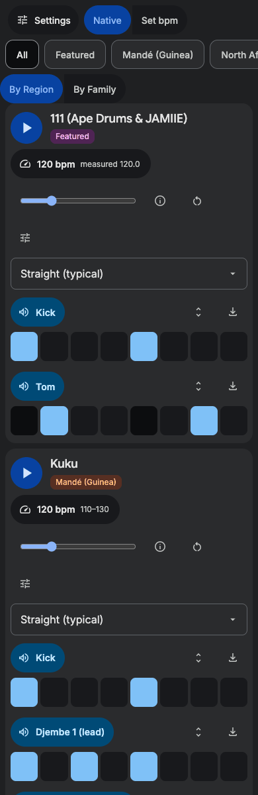

# Groove explorer

**https://billtribble.github.io/groove-explorer/**

A web app for auditioning drum rhythms — African, Afro-diasporic, and global percussion patterns — with their grooves. Stacked rows, one rhythm at a time, with per-pattern sound settings, family carousels, and bar-boundary switching.

## Features

- **100+ rhythms** from West African djembe ensembles, Ewe bell timelines, Gnawa trance, Ethiopian qenet, Brazilian samba groups, Cuban clave families, Middle Eastern iqa'at, Balkan odd meters, Indian talas, Flamenco compás, and more.
- **Multi-instrument ensemble patterns** — djembe+kenkeni+sangban+dununba, guembri+qraqeb, kebero+krar+masinko, all playable individually.
- **Family carousel view** — "By Family" groups similar rhythms (tresillo, son clave, samba, kuduro, Balkan odd meters, etc.) for side-by-side comparison.
- **Bar-quantized switching** — change pattern mid-play; the switch lands at the next bar boundary, perfectly aligned.
- **Per-pattern settings** — each row has its own top-voice selector and instrument mute toggles.
- **Etymology** — each rhythm shows its word origin and cultural context.
- **Live tempo** — tap any BPM chip to reveal an inline slider; drag to adjust in real time.
- **Groove engine** — Ableton Live 12 Core Library grooves, plain swings, and research-based feels.
- **Export** — individual parts as MIDI, or everything as an Ableton Live set.

## Usage

Open https://billtribble.github.io/groove-explorer/ in any browser. No installation, no build step.

To run locally: `python3 -m http.server 8765` then open http://localhost:8765.

## Data

- `js/rhythms.js` — rhythm library with patterns, family tags, etymology, and multi-instrument top-lines.
- `js/grooves-ableton.js` — generated from `.agr` files in Live's Core Library.
- `js/als-template.js` — Live 12 factory `DefaultLiveSet.als` for export skeleton.

## Stack

Plain HTML/CSS/JS. Zero build dependencies. Served via GitHub Pages.